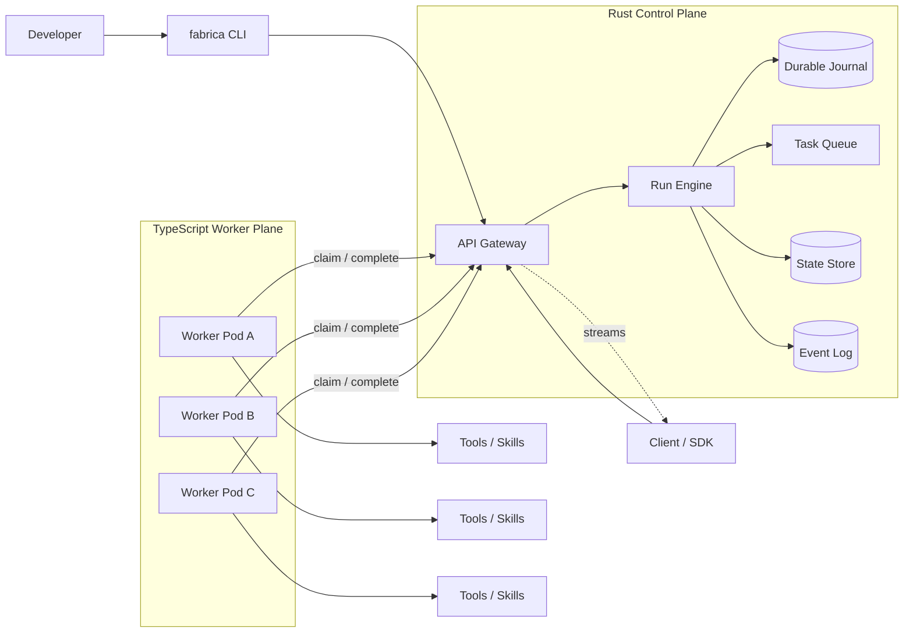

# Fabrica Architecture

This is the target architecture, not a description of the current runtime.
The repository currently contains a TypeScript package scaffold: schema
types, initial agent/tool definitions, and stub CLI/workflow/config
entry points. The Rust engine and distributed runtime below are planned.
Section 30 defines the implementation order and release gates.

Fabrica is a distributed AI agent framework with:

- **Vercel Eve-like DX**: file-first agents, TypeScript tools, Markdown prompts.
- **Hatchet-like execution**: durable tasks, distributed workers, retries, checkpointing.
- **Rust core engine**: actor scheduling, work stealing, state durability, high throughput.
- **RPC boundary**: Rust ↔ TypeScript via ConnectRPC, not FFI.

---

## 1. Core Goals

1. **Simple authoring**
   - Agents defined by folders/files.
   - Tools inferred automatically from TypeScript file names.
   - Prompts written in Markdown.

2. **Typed agent boundaries**
   - Every agent has explicit input/output types.
   - Agents behave like typed actors/functions.

3. **Durable execution**
   - Runs survive crashes.
   - Tasks can be retried or resumed.
   - Long-running workflows can park and resume.

4. **Distributed work stealing**
   - Agents/tasks are not pinned to one pod.
   - Any authorized worker with the required handler and pinned bundle can
     pick up work.
   - Many actors can run inside one pod.

5. **Performance**
   - Rust handles orchestration, scheduling, and state durability.
   - TypeScript handles developer-facing tools and business logic.
   - Local communication starts on loopback TCP; Unix Domain Sockets are
     an optional optimization.

---

## 2. High-Level Mental Model

Fabrica separates:

- **Control Plane / Engine**
  - Rust-based.
  - Manages runs, journals, queues, leases, retries, timers.
  - Run lifecycle: `queued` → `running` ↔ `waiting`, with terminal states
    `succeeded`, `failed`, and `cancelled`. Incompatible worker capacity
    is a scheduling reason, not a terminal state. Unknown effect
    outcomes are tracked separately from the run status.

- **Worker Plane**
  - TypeScript workers.
  - Execute tools, agent loops, skills, and workflow functions.
  - Connect to Rust engine through ConnectRPC.

- **Developer Surface**
  - File-based project structure.
  - TypeScript-first DX.
  - Markdown prompts.

- **Client Surface**
  - ConnectRPC HTTP API.
  - Generated TS SDK.
  - Streaming responses, cancellation, run status.

---

## 3. Repository Layout

```txt
fabrica/
├── agents/
│   ├── support-triage/
│   │   ├── agent.ts
│   │   ├── instructions.md
│   │   └── examples.md
│   └── code-reviewer/
│       ├── agent.ts
│       └── instructions.md
│
├── tools/
│   ├── get_weather.ts
│   ├── search_web.ts
│   └── create_ticket.ts
│
├── skills/
│   ├── summarize.md
│   ├── refund-policy.md
│   └── tone-friendly.md
│
├── workflows/
│   ├── ticket-triage.ts
│   └── release-notes.ts
│
├── fabrica.config.ts
└── .fabrica/
    └── generated/
        ├── tools.d.ts
        ├── agents.d.ts
        └── schemas.json
```

### Naming

Use:

```txt
workflows/
```

instead of:

```txt
orch/loop
```

`workflows/` is clearer and aligns with Hatchet/Temporal-style durable orchestration.

`fabrica.config.ts` also configures MCP servers (imported as tools) and
triggers. See sections 4.2 and 19.

---

## 4. Core Primitives

### 4.1 Agent

An agent is a typed actor.

It defines:

- Input schema
- Output schema
- System prompt
- Optional user prompt transformer
- Allowed tools
- Optional skills
- Optional model config
- Optional permission grants
- Optional run limits

Example:

```ts
// agents/support-triage/agent.ts
import { defineAgent } from "fabrica/agent";
import { z } from "zod";

export default defineAgent({
  input: z.object({
    ticketId: z.string(),
    message: z.string(),
  }),

  output: z.object({
    category: z.enum(["billing", "bug", "feature", "other"]),
    severity: z.enum(["low", "medium", "high"]),
    suggestedReply: z.string(),
  }),

  tools: ["search_docs"],

  skills: ["tone-friendly"],

  model: {
    provider: "openai",
    name: "gpt-4o",
  },

  permissions: ["read:docs"],

  limits: {
    maxSteps: 25,
    maxTokens: 200_000,
  },

  userPrompt: ({ input }) => {
    return `Triage this ticket:\n\n${input.message}`;
  },
});
```

The system prompt comes from:

```txt
agents/support-triage/instructions.md
```

`limits` are enforced by the engine, not the LLM:

- `maxSteps` bounds the reasoning/tool loop.
- `maxTokens` bounds accounted model tokens per run; it is not a dollar
  limit. Reserve usage before dispatch (section 25).

Exceeding a limit fails the run deterministically. This is a run failure,
not an LLM-visible error. Unbounded agent loops are a cost and liveness
hazard; caps are mandatory defaults, not opt-ins.

---

### 4.2 Tool

A tool is a typed, stateless TypeScript function.

Tool name is inferred from file name.

```txt
tools/get_weather.ts
```

becomes:

```ts
"get_weather";
```

Example:

```ts
// tools/get_weather.ts
import { defineTool, ToolError } from "fabrica/tool";
import { z } from "zod";

export default defineTool({
  input: z.object({
    city: z.string(),
  }),

  output: z.object({
    temperature: z.number(),
    summary: z.string(),
  }),

  // Optional: scopes this tool requires.
  // Engine refuses the call if the calling agent lacks the grant.
  requires: ["read:docs"],

  async execute({ input }) {
    return {
      temperature: 22,
      summary: `Weather in ${input.city} is clear.`,
    };
  },
});
```

Tools must be:

- Pure where possible.
- Stateless.
- Retry-safe.
- Idempotent where external effects occur.

#### Error taxonomy

Tool failures are not all the same thing. Three classes:

1. **LLM-visible error** (default for thrown `ToolError`):
   - Returned to the agent as an error tool-result.
   - Failure is information for the model; the run continues.
2. **Retryable error** (`new ToolError(msg, { retry: true })`):
   - Engine retries with bounded backoff only for retry-safe calls. If
     retries are exhausted, fail the run and record the exhausted task.
3. **Fatal error** (`throw new FatalRunError(...)`):
   - Terminates the run and records the failure for inspection.

Unexpected exceptions and invalid tool outputs are internal failures,
not raw messages to the model. A transport failure after a tool starts
is not proof that its external effect did not happen (section 8).

Classifying a failure wrong is a correctness bug: a flaky HTTP call fed
straight to the LLM wastes steps; a programming error retried forever
wastes money.

#### MCP tools

External MCP servers configured in `fabrica.config.ts` are imported as
tools under their server-prefixed names:

```txt
"github.create_issue"
```

Reject name collisions at registration. MCP tools use the same
allowlist and scope checks as file tools; discovery does not grant access.

---

### 4.3 Skill

A skill is a reusable capability package.

It can contain:

- Prompt fragments
- Model settings
- Few-shot examples
- Optional tool preferences

Example:

```md
<!-- skills/tone-friendly.md -->

Respond with a friendly, concise, professional tone.
Avoid jargon.
If unsure, ask a clarifying question.
```

Skills are attached to agents:

```ts
skills: ["tone-friendly", "summarize"];
```

Precedence rules:

- Prompt fragments: all skills compose, injected in listed order.
- Model settings: agent config wins over skills; among skills, later in the list wins.
- Tool preferences may prioritize tools already on the agent's explicit
  allowlist and never add tools or grant permissions.

---

### 4.4 Workflow

A workflow defines orchestration.

Workflows can:

- Call agents
- Call tools directly
- Branch
- Loop
- Fan out/fan in
- Wait for human approval
- Wait for external events

Example:

```ts
// workflows/ticket-triage.ts
import { defineWorkflow } from "fabrica/workflow";
import { z } from "zod";

export default defineWorkflow({
  input: z.object({
    ticketId: z.string(),
  }),

  output: z.object({
    resolved: z.boolean(),
  }),

  permissions: ["read:docs", "write:tickets"],
  tools: ["create_ticket"],
  agents: ["support-triage"],

  async run({ input, agent, tool }) {
    const triage = await agent("support-triage", {
      ticketId: input.ticketId,
      message: "Customer says billing is broken.",
    });

    if (triage.severity === "high") {
      // create_ticket requires ["write:tickets"] and human approval.
      const result = await tool(
        "create_ticket",
        { title: "High severity billing issue", category: triage.category },
        { id: "high-severity-ticket" },
      );
      if (result.status === "rejected") return { resolved: false };
    }

    return { resolved: true };
  },
});
```

Note: `if (triage.severity === "high")` is a branch on runtime LLM output.
Workflows support arbitrary TypeScript control flow. Execution semantics
are journal-based. See section 15.

---

## 5. Runtime Architecture



---

## 6. Rust Core Engine

The Rust engine is responsible for:

- Run registry and lifecycle
- Durable journal
- Task queue and leasing
- Actor lifecycle
- Checkpointing
- Retries, timeouts, timers
- Event logging
- Security enforcement
- Observability

### Runtime choice

Tokio at the edges, runtime-agnostic core:

- The actor kernel and queue/state-machine logic depend only on
  `futures` + `async-channel`/`async-lock`/`async-broadcast`.
  These crates are runtime-agnostic; they run fine under tokio.
- Tokio is wired only in the outer crate: tonic/axum (network),
  sqlx (Postgres), timers, telemetry.
- tonic and axum/hyper effectively require tokio. Fighting that is a
  permanent ecosystem tax. Conversely, smol's best primitives cost
  nothing to use under tokio.
- Keeping the core agnostic keeps it deterministic and cheap to test,
  fast to compile in the dev loop, and portable if the runtime is ever
  revisited (including thread-per-core io_uring options, which are the
  only genuinely interesting off-tokio alternative at high throughput).

Crate layout:

```txt
crates/
├── fabrica-core    # actor kernel, queue semantics, state machines
│                   # no I/O, no tokio
├── fabrica-engine  # tokio wiring: tonic, sqlx, redis, otel
└── fabrica-cli     # thin binary
```

### Other dependencies

- `axum` or `tonic` for APIs
- `sqlx` for Postgres
- Redis optional for hot cache; never for authoritative locks
- Postgres `LISTEN/NOTIFY` for v1 signals; NATS or Redis Streams deferred
- ConnectRPC for worker communication (section 9)

---

## 7. Actor Model

Every agent invocation is represented as a virtual actor.

"Actor" is a naming convention over a keyed, journaled state machine:

- The durable task queue records what can run next.
- An actor is journaled state scoped by tenant and actor ID.
- The engine activates an actor by leasing a task that targets it.

Actor properties:

- Actor ID
- Agent ID
- Run ID
- Mailbox
- State checkpoint
- Parent actor
- Child actors
- Status

Actor behavior:

- Receives messages.
- Processes one message at a time.
- Persists state after meaningful steps.
- Parks when idle.
- Resumes when new input arrives.

Activation semantics:

- First message to an actor ID activates it: engine loads state from
  the journal and dispatches.
- At most one activation lease epoch can advance an actor. A short
  transaction locks the actor row to assign the epoch, then releases
  the lock before execution. Child/tool tasks have their own leases;
  their completions record results but do not execute the parent actor.
  Serialize the readiness check with result recording so fan-in queues
  only one wakeup. Lease expiry does not stop a stale worker; fenced
  commits prevent it from advancing state.
- Parked actors wake via queue tasks or event subscriptions.

Garbage collection:

- Collect terminal actor state according to the tenant's run retention
  and replay eligibility rules (section 22).
- Session context has its own retention rules (section 18).

Sub-agents are child actors.

Parent actors should not block waiting for children.

Instead:

1. Parent spawns child actor.
2. Parent parks/checkpoints.
3. Child completes and its result and the parent's wakeup are committed
   in the same transaction. An early completion cannot lose the wakeup:
   the park operation must check for an already recorded result.
4. Parent resumes under a new lease, with no worker slot held while parked.

This avoids thread pool exhaustion and deadlocks.

---

## 8. Task Queues and Delivery Semantics

Fabrica uses a Hatchet-like distributed worker model.

("Work stealing" here means shared-queue claims and lease takeover across
workers/pods, not in-process scheduler stealing.)

### Delivery semantics

- Delivery is **at-least-once** for retry-safe work, subject to retry
  limits. Duplicate execution is possible; stable logical task IDs do
  not make external effects exactly-once.
- Persist the tool call ID and validated input before dispatch. Reuse the
  same idempotency key across attempts, namespaced by tenant/tool where
  needed, and ensure the provider's deduplication window covers retries.
- External fencing is useful only if the destination enforces it using a
  token monotonic for the protected resource. An actor-local epoch does
  not fence writes from different actors to the same resource.
- Effects with no credible deduplication or recovery strategy are not
  automatically retried after an ambiguous outcome. Record an unknown
  effect outcome and require reconciliation before any new attempt.

### Lease protocol

1. A worker claims only when it has a free slot. In one short transaction
   the engine matches tenant, capabilities and bundle, assigns the lease
   owner and increments the epoch. Expiration uses database time. Reuse
   a claim request ID after a lost reply; the same request must not
   allocate a second task.
2. Heartbeat, checkpoint and completion requests must match the current
   owner and epoch and arrive before expiry. Renewal cannot revive an
   expired lease or extend execution beyond the task deadline.
3. Completion atomically finishes the task, appends the journal entry,
   updates run state, and enqueues any successor or durable wakeup. A
   retried completion from the same owner and epoch with the same
   payload returns the already committed outcome even after expiry.
   Conflicting payloads and stale mutations are rejected.
4. An expired lease is fenced off and re-dispatched with backoff only if
   retry-safe and still admissible under the run deadline and attempt
   budget. Never hold database locks across RPC or user code. Redis and
   notifications may accelerate wakeups, but polling must recover
   missed notifications.

### Queue implementation

- v1: Postgres. `FOR UPDATE SKIP LOCKED` for claims, with persisted
  leases and the same transaction boundary as the journal.
- Any future broker is a delivery hint unless it can preserve these
  commit and recovery guarantees. Throughput is a benchmark, not a claim.

### Local dev

The durability path uses Postgres locally too. An in-memory emulator can
be used for unit tests or previews, but is not restart-safe and is not a
substitute for Postgres integration tests.

### Failure handling

If a worker dies mid-task:

- Lease expires.
- Retry-safe work can be picked up by another compatible worker.
- Non-repeatable effects whose execution cannot be ruled out are
  marked unknown instead.
- Execution resumes from the last committed checkpoint, not from a
  worker's stack or a partially streamed response.

### Dead letters

After max retries, record the task in a dead-letter queue and fail its run.

The DLQ is inspectable. Redrive is an audited operation, not a reset of
terminal run state or an automatic replay of an unknown effect. Do not
enable redrive until it can preserve pinned definitions and prior
idempotency keys and enforce reconciliation where needed.

A pod can host:

- Many workers.
- Many concurrent tasks.
- Many actor executions.

Tasks are not tied to pods.

Pods are disposable execution capacity.

---

## 9. Rust ↔ TypeScript Boundary

Fabrica does not use FFI for user code. Workers initiate unary Connect
RPCs to register a bundle, claim work with a bounded long poll, renew
leases, and submit checkpoints and completions. A worker reconnects and
retries requests after transport failures; the persisted lease, not the
connection, governs ownership. Heartbeat responses indicate when work
must stop. Workers send bounded, best-effort preview batches separately
from durable checkpoints (section 17).

v1 targets Node.js and loopback TCP for local dev. The dev supervisor
uses a per-launch worker credential; binding to loopback is not
authentication. Production uses TLS with authenticated worker identities
and mTLS on inter-service links. The engine never dials workers.
Bidirectional gRPC and Unix Domain Sockets are optional follow-ups, not
requirements for the first release (section 28).

---

## 10. TypeScript Worker

The TypeScript worker is a long-running process.

It:

- Authenticates and advertises handlers for an authorized bundle.
- Claims tasks only when it has capacity.
- Executes tools, agent loops, and workflow functions.
- Returns typed results.
- Reports errors.
- Heartbeats leases.
- Sends logs/traces.

The v1 Node.js worker uses a bounded worker-thread pool. Other TS
runtimes are not part of the first release contract.

### Isolation limits — honest version

The supervisor can enforce task deadlines and concurrency caps by
terminating worker threads, but threads are not a security boundary.
Node's isolate heap limits do not cap all memory or CPU use, and
terminating a thread cannot retract external effects.

Options for real limits:

- `isolated-vm` (V8 isolates with memory limits)
- Subprocess per task + cgroups
- WASM sandbox (later)

v1: worker-thread pool + timeouts + per-worker concurrency caps.
Real resource sandboxing is a later phase. Do not claim limits the
runtime cannot enforce.

---

## 11. Hot State vs Durable State

This is critical.

### Hot State

Kept in worker/engine memory or an optional Redis cache. Losing hot state
must not change durable outcomes.

Includes:

- Active LLM conversation context.
- Current reasoning loop.
- Temporary scratchpad.
- Cached actor state; pending mailbox work is durable.
- Live token streams.

Hot state is optimized for latency.

### Durable State

Stored in Postgres/journal.

Includes:

- Workflow run status.
- Step checkpoints (journal entries).
- Tool call results.
- Approval states.
- Agent outputs.
- Retry metadata.
- Committed assistant messages and other data needed for replay, subject
  to the data-handling rules in section 22.

Durable state is optimized for recovery.

### Rule

Do not checkpoint every tiny LLM thought to Postgres.

Checkpoint at meaningful boundaries:

- Workflow step completed.
- Tool call completed.
- Agent produced output.
- Assistant message completed.
- Human approval requested.
- External effect intent before dispatch and its observed outcome after
  completion. The provider call itself is outside the database transaction.

An assistant message is complete for Fabrica once its checkpoint commits,
not when the provider stops streaming. On crash, an uncommitted model
turn may be attempted again (and billed again). Partial tokens are
ephemeral, not recovery state.

---

## 12. Execution Flow

TypeScript owns prompt assembly and provider calls; Rust owns state
transitions and authorizes each durable step (Decision D1).

1. The engine creates the run, pins a bundle, and queues a model turn
   in one transaction. Before dispatch it reserves step and usage budget.
2. A compatible worker leases the turn, reconstructs context from the
   journal, calls the model, and optionally publishes token previews.
3. The worker returns a completed turn. A fenced completion records the
   turn and either finishes the run with validated output or records
   authorized tool intents and parks the actor. The model worker releases
   its slot rather than waiting on the tool or a human.
4. Tool workers execute approved, eligible intents under their own
   leases. Tool results and the next model turn's wakeup are committed
   together. Where a turn requests multiple tools, the results are
   reconstructed in the original call order, not completion order.
5. After a crash, another compatible worker continues from the last
   committed boundary under a new lease epoch. Parked runs hold no lease.

The engine counts model turns and tool dispatches against the step
limit; a deliberate retry of a model call also requires a fresh usage
reservation. Request batching cannot bypass these limits.

---

## 13. Auto-Inference, Schemas, and DX

Fabrica should provide strong autocomplete.

When developer writes:

```ts
tools: [""];
```

The IDE should suggest:

```ts
"get_weather";
"search_web";
"create_ticket";
```

Implementation:

1. CLI scans `tools/`.
2. CLI parses tool names and schemas.
3. CLI generates `.fabrica/generated/tools.d.ts`.
4. Agent definitions use generated literal types.

Example generated type:

```ts
export type ToolName = "get_weather" | "search_web" | "create_ticket";
```

Agent definition:

```ts
tools: ToolName[]
```

This gives compile-time validation and autocomplete.

### The schema bridge

Schemas live in TypeScript. A [Standard Schema](https://standardschema.dev)
validator also needs a supported JSON Schema export or an explicit
adapter. The examples use Zod for illustration. The engine needs the
wire schemas for enqueue and completion validation; the model sees a
provider-compatible rendering of the tool input schemas.

User-facing contract — either a Standard Schema, or an explicit
adapter:

```ts
// Any Standard Schema implementation
defineAgent({ input: z.object({ ... }) });

// Explicit adapter: the escape hatch for typia (which needs its own
// compile transform), MCP-imported tools, and hand-written schemas
defineAgent({
  input: {
    validate: (value) => ...,        // Standard Schema Result shape
    jsonSchema: () => ({ ... }),     // JSON Schema, draft 2020-12
  },
});
```

Bridge:

1. The trusted build/registration path exports input and output wire
   schemas into `.fabrica/generated/schemas.json`; validators stay in
   the executable bundle. Use Standard JSON Schema where available,
   otherwise an explicit supported exporter or adapter. Fail registration
   if a schema cannot be exported. Accept only Draft 2020-12, with local
   references and a documented keyword/format policy; never fetch remote
   references at validation time.
2. The engine validates wire input before enqueue and wire output before
   durable completion. The worker runs the original validators before
   invocation and before returning output. A worker may reject a
   structurally valid value due to refinements the wire schema cannot
   express; classify that as validation failure, not a transient error.
3. Hash each wire schema with SHA-256 over RFC 8785 canonical JSON.
   The engine verifies the registered hashes against the manifest;
   matching hashes alone do not identify validator logic or executables
   (section 16).

Rules:

- The input wire schema describes the serialized value before worker
  validation; a local input transform may produce a richer handler value.
  The output wire schema describes the validated value after any
  transform, serialized for the journal. Outputs without a JSON
  representation need an explicit wire mapping (for example, a date to
  an ISO string). Replay returns the committed wire result, not a
  second application of the output transform.
- `fabrica` has no required schema peer dependency.
  `@standard-schema/spec` (types only) is a regular dependency; zod,
  valibot, and arktype are optional peers used by the extractors.

---

## 14. Agent Definition Contract

Each agent folder should contain:

```txt
agents/my-agent/
├── agent.ts
├── instructions.md
└── examples.md
```

Minimum required:

```txt
agent.ts
instructions.md
```

`agent.ts` defines:

- Input schema
- Output schema
- Tools
- Skills
- Model config
- Permissions
- Limits
- Prompt assembly

`instructions.md` defines:

- System prompt
- Behavioral rules
- Constraints

`examples.md` optional:

- Few-shot examples
- Evaluation cases

---

## 15. Workflow Execution Model

Workflows support:

- Sequential steps
- Parallel branches
- Retries
- Timeouts
- Human approval
- Event waiting
- Agent delegation
- Error recovery
- Arbitrary TypeScript control flow, including branches on agent output

### Execution semantics: journal + memoized re-execution

The workflow function runs in a TypeScript worker. Durability comes
from the journal, not from compiling the function away.

1. The workflow function executes from its start under its pinned bundle.
2. Each SDK operation has a deterministic ID. Sequential calls may use
   ordinals assigned at invocation. Parallel branches and repeated named
   steps require explicit, unique IDs derived from stable input keys,
   not completion order. Use structured fan-out/fan-in; do not branch
   on `Promise.race` or transient completion timing.
3. The engine records the intent (ID, kind, target, canonical input
   fingerprint) before scheduling effects, then commits the outcome
   before making it visible to the workflow. Wait subscriptions and park
   transitions are durable; matching events cannot be lost in a race
   with registration (section 19).
4. Replay verifies the intent against the journal and returns the
   committed outcome, including any workflow-visible error. A mismatched
   intent or a workflow returning without consuming recorded steps
   fails replay. A pending step parks and releases the workflow's slot;
   a new activation replays when it can make progress.

Data-dependent branches are valid because they are re-derived from
journaled outcomes. Step matching detects divergent durable operations,
not all possible nondeterministic local computation.

### Rules for workflow code

- Side effects happen only inside steps (`agent`, `tool`, `wait`).
- Code between steps is pure local computation and may re-run many
  times. Keep it cheap.
- No `Date.now()` / `Math.random()` or external reads in workflow code;
  use a durable timer or journaled step for time or randomness. A dev
  checker can flag common sources, but cannot prove determinism.

### Division of labor

```txt
TypeScript expresses workflow structure.
Rust owns the journal, scheduling, retries, timers, and wakeups.
```

Static compilation is a possible future optimization, but must preserve
the same semantics, including branches on journaled runtime results.

---

## 16. Versioning and Migration

Durable execution plus code changes is the classic footgun. Rules:

- A deploy publishes an immutable, content-addressed project bundle:
  executable handlers, prompts, resolved skill/config manifests and schemas,
  dependency artifacts or pinned worker image, and the worker ABI.
  Credentials and live authorization policy are not bundled.
- A run and its children pin that bundle. Workers may claim only for
  supported bundle/ABI combinations. Keep old worker capacity during
  rollouts, or be able to load old bundles. Surface missing capacity
  as blocked, not as a retry or a fallback to latest.
- A rename or schema change affects new runs only. Old references resolve
  within their original bundle. Journal entries must remain readable
  under the pinned contract; live-run migration is not supported in v1.
- Retain bundles and replay data while any retained run may resume or
  be redriven. Expire eligibility before deleting either. Upgrade
  database and journal formats separately using backward-compatible
  migrations while old readers or writers are still active.

Start strict. Loosening pinning later is easy; recovering trust after
silent corruption is not.

---

## 17. Streaming and Cancellation

### Streaming

Agent runs stream tokens to clients:

- Connect server streaming from the API gateway to the client. Workers
  publish previews through the engine; cross-node preview fan-out is
  optional. Preview chunks are scoped to the run, turn and attempt.
- After reconnect, buffer loss or attempt replacement, the client
  discards previews and reloads committed state via `Get`. No token
  replay guarantee. Missing previews do not affect the run.

Backpressure:

- Bounded buffers.
- Slow clients drop to polling run status instead of stalling the run.

### Cancellation

Cancellation must propagate end to end:

1. Client cancels run.
2. Cancellation and completion serialize on the run record; the first
   terminal commit wins. Cancellation prevents new task claims or step
   commits for the run. A later cancel returns the existing terminal state.
3. The transaction records cancellation and durable cleanup work for
   queued tasks, waits and attached children. Child dispatch and
   completion also check the ancestor cancellation barrier; detached
   children are not covered.
4. Active lease holders observe cancellation on heartbeat and make a
   best-effort abort. Cancellation cannot undo a provider call already
   in progress or an external effect already accepted.
5. Previously committed steps remain visible. Partial token previews
   are discarded; uncertain external effects still require
   reconciliation even though the run is `cancelled`.

Cancellation is a first-class run state, not an error.

---

## 18. Sessions and Memory

Multi-turn chat is the most common agent workload. It needs a
primitive, not just a Redis line item.

- A **session** is durable conversation state keyed by tenant and session ID.
- Runs reference a session: `fabrica.run("support-triage", { input,
sessionId })`.
- Session stores rolling transcript, summary, and TTL.
- v1 permits one nonterminal run per session. Session admission and
  transcript updates are transactional with run transitions. Parked
  runs retain the session slot without holding a worker lease.
- Each run pins the context revision it starts with. Compaction creates
  a new revision and cannot rewrite context needed by in-flight runs.
  Session expiry must not delete state still required by a resumable run.

---

## 19. Triggers, Cron, and Webhooks

Runs start from more than client calls:

```ts
// fabrica.config.ts
export default defineConfig({
  triggers: [
    { cron: "0 9 * * 1-5", workflow: "release-notes" },
    { webhook: "/hooks/github", workflow: "ticket-triage" },
    { event: "ticket.created", agent: "support-triage" },
  ],
});
```

- Cron: v1 uses UTC. A unique key on `(tenant, schedule, scheduled UTC
  instant)` provides at-most-one run admission per eligible slot. The
  scheduler advances its durable cursor in the admission transaction;
  bound outage catch-up and record skipped slots.
- Webhooks: authenticate the raw delivery, validate it, and deduplicate
  by tenant, trigger and provider delivery ID before acknowledging
  durable admission.
- Events: persist incoming events with tenant-scoped IDs before
  notification. A wait pins a lower-bound cursor from an earlier durable
  boundary, such as creation of the action that solicits the event.
  Match events after it even if they arrived before subscription commit.
  Use a commit-ordered event position or scan for unprocessed events
  without advancing past uncommitted inserts. Deduplicate trigger
  admissions and wait resolutions in the same transaction as their
  wakeups. `LISTEN/NOTIFY` is a hint, not the log.

---

## 20. Client API Surface

How user applications invoke Fabrica:

```txt
fabrica.v1.Runs
  Create     -> run id (idempotency-keyed within the retention window)
  Stream     -> token/event stream for a run
  Get        -> status, output, step history
  Cancel     -> cancellation (section 17)
  List       -> paginated, scoped to the caller's tenant
fabrica.v1.Approvals
  Resolve   -> record an authorized approval or rejection
```

- Protocol: ConnectRPC over HTTP; generated TS SDK from the same proto.
- `Create` accepts optional `sessionId` (section 18).
- Derive tenant from the authenticated principal, not request input.
  Authorize each operation on the addressed resource.
- `Create` deduplicates by tenant, operation and key, binding the key to
  the canonical request. Commit the key and run together. Return the
  original run for a matching request and a conflict for a different
  payload. Advertise the key retention window.

---

## 21. Human-in-the-Loop

Agents can pause for approval.

Example cases:

- Sending email.
- Refunding customer.
- Deleting data.
- Executing payment.
- Publishing content.

Flow:

```txt
1. An agent or workflow requests a tool that requires approval.
2. Engine persists the exact validated action (target, bundle, step,
   input digest, expiry) before dispatch and parks the run.
3. An authorized approver resolves the gate through the authenticated API.
4. Resolution and wakeup are committed together; repeat resolutions are
   idempotent for the same decision and conflicting decisions fail.
5. Only approval of this exact intent can make it dispatchable; reject,
   expiry, cancellation or changed input cannot authorize the effect.
```

Approval is additional to authorization, not a grant. Recheck live
policy before issuing the tool lease. Audit the approver, decision and
time. The workflow example uses an approval-gated tool whose SDK
outcome distinguishes execution from rejection; no handler runs on
rejection. Arbitrary waits for human input are not security gates.

---

## 22. State Stores

### Postgres

Primary durable store.

Stores:

- Runs
- Journal/step checkpoints
- Approvals
- Task leases and queue
- Agent outputs
- Definition bundles and versions
- Session revisions, incoming events and trigger deduplication keys
- Audit logs

### Redis

Optional hot cache; not required for v1 correctness or deployment.

Stores:

- Session working set
- Actor activation hints
- Rate limits
- Live stream fan-out state

### Event bus

- v1: Postgres `LISTEN/NOTIFY` + poll. One dependency, good enough.
- Later: NATS or Redis Streams for cross-node scale, webhooks at
  volume, audit streaming. Behind an interface; not load-bearing for
  correctness.

### Retention and PII

Agent workloads ingest user data (support tickets, chat history).

- Set per-tenant retention on runs and transcripts. Journal entries
  needed for replay cannot expire independently of run eligibility.
- Redact previews, logs and audit payloads; minimize and encrypt
  sensitive replay data. Do not apply lossy redaction to replay inputs
  or outputs unless the redacted value is also the value used live.
  Deletion requests that remove required history first make the
  affected runs non-resumable.
- Audit log retention is configured separately from journal retention.

---

## 23. Deployment and Distribution

### Distribution

`fabrica` is a Rust binary plus a TypeScript runtime.

Install paths:

- `npm i fabrica` — npm package downloads the prebuilt platform binary
  (esbuild model). Primary path; DX depends on no Rust toolchain.
- `cargo install fabrica` — for Rust users.
- Docker image — engine and worker images.

### Local Development

```txt
fabrica dev
```

Starts:

- Rust engine (prebuilt binary).
- TypeScript worker supervisor.
- A connection to local Postgres when running the durable engine.
- File watcher.
- Generated type builder.

One command supervises the engine and worker. Postgres can be supplied
by the developer or a local container.

### Single-Node Production

Runs:

- Rust engine container.
- Postgres.
- Optional Redis.
- One or more TS worker containers.

### Kubernetes

Deployments:

```txt
fabrica-control-plane
fabrica-worker-pool
fabrica-gateway
```

Workers scale horizontally.

Pods can be preemptible because tasks are durable.

---

## 24. Scaling Model

Scaling is based on task queues.

Add more workers when:

- Queue depth grows.
- Tool execution latency grows.
- CPU/memory saturates.
- Agent concurrency increases.

Run multiple stateless engine instances that coordinate claims and
cron admissions in Postgres. Defer queue or actor sharding until a
measured bottleneck justifies it.

---

## 25. Security Model

### Authentication

- API requests use JWT/API keys.
- Workers authenticate to engine.
- Inter-service traffic uses mTLS in production.

### Authorization

- Agents and workflows declare tool/child allowlists and requested
  scopes. Before recording an intent, intersect those scopes with live
  tenant policy and the invocation's delegated grants, then require all
  tool scopes. Recheck live policy at dispatch. A child can inherit only
  a subset of its parent's effective grants; never union grants.
- Tag every durable record and RPC resource with tenant identity; use
  tenant-scoped lookups and relationships for claims, streams, wait
  resolution and bundle access. A worker identity is authorized for
  specific tenant/bundle assignments; self-registration is not trust.
- v1 executes trusted project code. Worker threads, schemas and
  allowlists do not contain arbitrary JS or prevent direct network
  calls. Do not share a v1 worker process across mutually untrusted
  projects; use separate credentials and deployment boundaries.

### Cost governance

LLM spend is a security-adjacent concern:

- Per-run `maxSteps`/`maxTokens` limits (section 4.1).
- Reserve per-run and per-tenant usage atomically before each provider
  attempt, including retries. Bound requested output, reconcile with
  reported usage, and conservatively account for attempts whose usage is
  unknown. Exact dollar caps are not promised when provider billing is
  delayed or not bounded by the request.
- Honor provider Retry-After with capped, jittered backoff and shared
  concurrency/rate controls per provider credential.

### Secrets

Secrets are never stored in agent files.

Use:

- Environment secrets for local dev.
- Vault/KMS for production.
- Runtime secret injection.

Example tool API:

```ts
const apiKey = await secrets.get("weather_api_key");
```

### Sandboxing

Tools run in worker isolation.

Limits (phased honestly):

- v1: timeouts, concurrency caps, payload size.
- v2: memory-capped isolates or subprocess + cgroups.
- Future: WASM sandbox for untrusted tools; network egress policy per
  tool.

---

## 26. Observability

Every run should produce:

- Trace ID
- Run ID
- Actor ID
- Step ID
- Tool call ID
- Tenant ID

Metrics:

- Run duration
- Step duration
- Tool success rate
- Queue depth
- Worker utilization
- Token usage and cost per run/tenant
- Retry count
- DLQ size
- Approval wait time

Tracing:

- OpenTelemetry spans.
- Span per agent step.
- Span per tool call.
- Span per LLM call.

Logs:

- Structured JSON.
- Correlated by run ID.

---

## 27. Performance Strategy

To stay fast:

1. Rust handles orchestration and durability.
2. Target orchestration overhead under 1% for model turns in the
   benchmark workload; measure queue, RPC and commit latency separately
   for short tool calls.
3. Tools execute through RPC only when needed.
4. Benchmark loopback TCP before optimizing local transport.
5. Workers are warm, not cold-started.
6. Payloads are small and typed.
7. State is checkpointed at boundaries, not every token.
8. Sub-agent calls are async, not blocking.
9. The queue and journal share Postgres transactions for atomic
   progress; measure commit overhead rather than assume an fsync count.

Target metrics to benchmark:

- Agent cold start.
- Task dispatch latency.
- Tool RPC round-trip.
- Journal write latency.
- Actor resume latency.
- Workflow replay time (steps/sec from journal).
- Throughput per worker.
- Memory per actor.

---

## 28. v1 Design Decisions

These are the proposed v1 defaults; revisit them only if the release
gates in section 30 expose a concrete problem.

### D1: Model turns run in TypeScript

Use the TypeScript provider ecosystem without porting prompt assembly
or provider adapters to Rust. The engine grants work and commits
boundaries, so a dead worker cannot lose committed progress. A separate
RPC/checkpoint per turn is the tradeoff.

### D2: Unary Connect RPC for workers

Use bounded long polling and separate renew/complete calls. Keep
Connect server streaming for public previews. Verify both through the
intended ingress early, including timeouts and buffering. Bidi gRPC
push and Unix Domain Sockets remain performance options.

### D3: Worker isolation technology

Worker threads for trusted code. A separate security design and
isolation review is required before supporting untrusted code.

### D4: Event bus

Postgres durable events, polling and optional `LISTEN/NOTIFY` hints
for v1. Defer a broker until there is evidence it is needed.

---

## 29. Known Gaps and Mitigations

### Gap 1: RPC Overhead

Risk:

- Rust ↔ TypeScript RPC adds latency.

Mitigation:

- Keep tool payloads small.
- Batch ephemeral previews; benchmark claims and journal commits
  before changing transport.

### Gap 2: Durable State vs Fast Loops

Risk:

- Checkpointing every step slows execution.

Mitigation:

- Separate hot state and durable state.
- Checkpoint only meaningful boundaries.
- Keep diagnostics asynchronous, but commit recovery-critical events
  and wakeups with state changes.

### Gap 3: Workflow Determinism Footguns

Risk:

- Users write non-deterministic workflow code; replays diverge.

Mitigation:

- Deterministic step IDs + loud determinism errors (section 15).
- Replay tests; dev-mode checks as an aid, not a guarantee.
- Engine-provided time/random inside steps.

### Gap 4: Sub-Agent Deadlocks

Risk:

- Parent waits for child and blocks worker threads.

Mitigation:

- Parent parks.
- Child completion event resumes parent.
- Use async actor messaging.

### Gap 5: Stateful Tools

Risk:

- Tools store local memory and break retries.

Mitigation:

- Tools must be stateless.
- External effects need a retry classification and stable tool call ID
  for deduplication.
- Fencing tokens for supporting external systems.

### Gap 6: Double Execution Under At-Least-Once

Risk:

- Non-idempotent external effects execute twice on lease takeover.

Mitigation:

- Fence authoritative commits; deduplicate at the destination where
  possible (section 8).
- Escalate ambiguous, non-repeatable effects for reconciliation.

### Gap 7: Versioning Complexity

Risk:

- Definition changes corrupt or break in-flight runs.

Mitigation:

- Content-hashed, pinned definitions (section 16).
- Loud failures at replay, DLQ for unrecoverable runs.
- Keep compatible worker capacity for pinned bundles during rollouts.

### Gap 8: Streaming Fan-Out on the Engine

Risk:

- Engine becomes a token router and a bottleneck.

Mitigation:

- Streams are hot and ephemeral; journal is truth.
- Bounded buffers; slow clients degrade to polling.
- Keep preview upload and fan-out off the durable completion path.

### Gap 9: Developer Experience Complexity

Risk:

- Distributed system concepts leak to developers.

Mitigation:

- Hide queue/worker details behind `fabrica dev`.
- Use file-based conventions.
- Generate types automatically.
- Provide local emulator.

---

## 30. MVP Scope and Release Gates

### Phase 1: Project model and transport spike

Implement discovery, `init`, manifest/schema export, and generated
types. Verify unary Connect and public server streaming between Rust
and Node through the intended proxy. Gate: reject unsupported schemas
at build time and share input/output validation and canonical hash
fixtures between Rust and TypeScript.

### Phase 2: Durable vertical slice

Deliver `dev` against Postgres and one agent with a retry-safe tool.
Include the run/lease/journal transaction contract, bundle pinning,
trusted worker authentication, bounded retries, cancellation,
idempotent creation and budget reservations. Use a fake provider for
deterministic fault tests and a real provider for a smoke test.

Gate: on Postgres, kill a worker before and after commit; test expired
leases with two workers, stale completions, duplicated completion RPCs,
lost notifications, cancellation/completion races and an ambiguous
external effect. The journal must advance once, retry-safe work must
recover, and ambiguous non-repeatable work must not be reissued.

### Phase 3: Distributed agent MVP

Add multiple workers, preview streaming, deploy/rollback support,
retention, and DLQ inspection. Gate: resume a run pinned to an older
bundle during a rolling deploy; disconnect a slow stream reader without
delaying completion; prove that principals and workers cannot claim,
read, stream or mutate another tenant's resources.

### After the agent MVP: Workflows, sessions and triggers

Add workflow replay, durable waits and approvals, then versioned
session context and durable trigger admissions. Do not enable
approval-required tool dispatch until approval enforcement is shipped.
Gate: replay branching and fan-out with reordered completions, race
event delivery with wait registration, reject approval for changed
input, and deduplicate cron/webhook admissions. Defer MCP import,
untrusted tool execution, alternative brokers and live-run migrations.

---

## 31. Final Architecture Summary

Fabrica is:

```txt
File-based agents.
TypeScript developer experience.
Rust control plane: queue, journal, leases.
Hatchet-like durable workers.
ConnectRPC boundary.
Lease-takeover execution.
Durable checkpoints.
Journal-based workflows.
At-least-once delivery with idempotent tools.
```

The key architectural rule:

```txt
Author in TypeScript.
Orchestrate and persist in Rust.
Execute tools and logic in TypeScript workers.
Pin every run to a definition version.
Keep streams hot, truth durable.
Keep hot loops fast.
```
